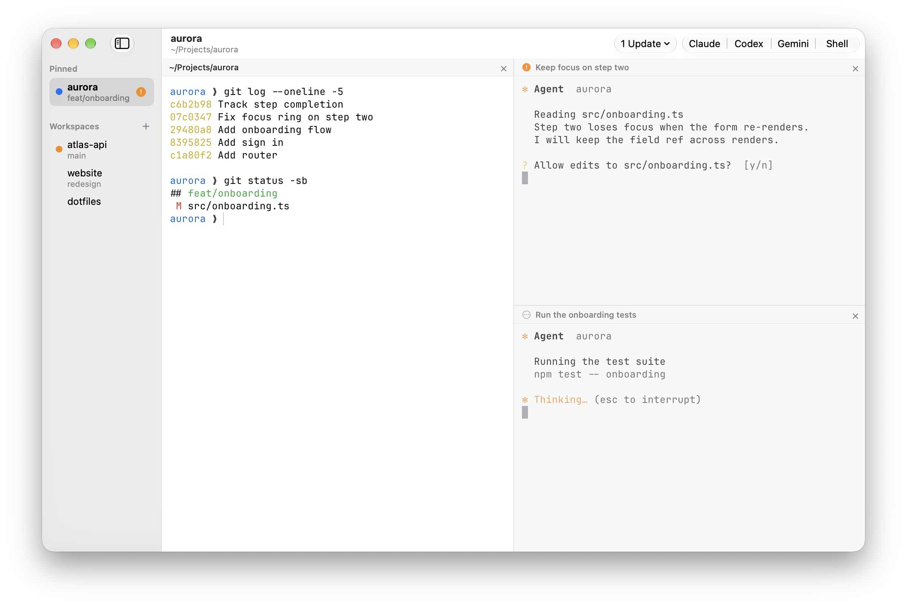

<p align="center">
  <picture>
    <source media="(prefers-color-scheme: dark)" srcset="docs/images/icon-dark.png">
    
  </picture>
</p>

<h1 align="center">Beam</h1>

A native macOS terminal for running coding agents. Swift and AppKit on top of
[libghostty](https://github.com/ghostty-org/ghostty), and nothing else: no
browser, no web views, no bundled runtimes.

Run Claude Code, Codex, Gemini and Kimi side by side, one workspace per
project. Quit whenever you like: the agents keep working, and every pane comes
back when Beam opens again.

<picture>
  <source media="(prefers-color-scheme: dark)" srcset="docs/images/screenshot-dark.png">
  
</picture>

## What it does

- **Workspaces and splits.** One workspace per project folder, each with its
  own split layout. The sidebar shows each workspace's git branch and what its
  agents are doing. Cmd+P switches between workspaces and panes, and Cmd+1 to
  Cmd+9 jump straight to one.
- **One-click agents.** The title bar has a button for each agent CLI your
  login shell can find, plus a plain shell. New agent panes tile themselves.
- **Agent state.** Claude Code and Codex report working, waiting and done
  through their own hooks, keyed by pane rather than guessed from the screen.
  The sidebar marks the panes that need you, Cmd+Shift+U jumps to the next
  one, and a notification arrives while Beam is in the background.
- **Sessions survive quit.** A small background process, `beamd`, owns every
  pane's shell. Quit Beam, or have it crash, and shells and agents keep
  running; open it again and each pane is back with the same process, screen
  and scrollback. Beam > Quit and End Sessions stops them all.
- **Agent updates.** The Agents menu shows each agent's installed and latest
  version and how it was installed (Homebrew, mise, npm, uv or its own
  installer), and updates it in one click.
- **Your Ghostty setup.** Beam reads `~/.config/ghostty/config`, so themes,
  fonts and keybindings carry over. It follows macOS light and dark mode.

## Numbers

Release build on an M2 MacBook Air with macOS 27.2, default 1100x700 window on
its Retina display.

| | Measured | Budget |
|---|---|---|
| App bundle | 23MB | 30MB |
| Memory, one window with an idle shell | 78MB | 80MB |
| Memory, a shell and four Claude Code panes | 113MB | 200MB |
| Cold launch to first prompt | 358ms median | 400ms |

Memory is the physical footprint, the figure Activity Monitor shows, of the app
and `beamd`, plus one `beam-attach` per pane in the four-pane reading. The
agents' own processes are not counted, since they cost the same in any
terminal.

- `make check` fails over the bundle budget.
- `make bench` runs Beam in an empty home and fails over the idle memory budget.
- `make launch` launches Beam ten times with nothing of it running, and fails
  when the median goes over the launch budget. It times from the kernel
  starting the process to the shell's first prompt reaching the terminal, with
  a zsh that reads no dotfiles. Your own shell config adds its startup time on
  top, in any terminal (`time zsh -lic exit` shows how much). The first launch
  after installing takes longer while macOS checks the new app.
- The four-pane reading is taken by hand.

## Install

Beam runs on Apple Silicon Macs. It has been tested on macOS 27; the app asks
for macOS 14 or later, but older versions are untested.

Download `Beam-0.1.0.zip` from the
[releases page](https://github.com/fabienbrocklesby/beam/releases), unzip it
and move Beam.app to Applications. The app is signed ad hoc, not notarized, so
macOS refuses to open it until you clear the quarantine flag once:

```sh
xattr -dr com.apple.quarantine /Applications/Beam.app
```

Or build it yourself.

## Build

Needs Xcode, Zig 0.17 (the version in `vendor/ghostty/build.zig.zon`) and
Xcode's Metal toolchain.

```sh
git clone --recursive https://github.com/fabienbrocklesby/beam.git
cd beam
xcodebuild -downloadComponent MetalToolchain   # once
make ghostty                                   # libghostty, a few minutes
make app                                       # build/Beam.app
make run
```

## Configuration

Beam uses Ghostty's config format. It loads its own defaults, then your Ghostty
config, then `~/.config/beam/config.ghostty` for settings that should change
Beam alone. Beam > Settings (Cmd+,) opens that file, and Cmd+Shift+, reloads
it.

## How it works

Each pane is a libghostty surface: libghostty does the terminal emulation,
Metal rendering and font shaping. The surface runs `beam-attach`, a small C
program that pumps bytes to `beamd`, which owns the pane's real pty and keeps a
copy of its screen in a headless libghostty-vt terminal. When Beam opens again,
beamd replays that screen, so the pane looks exactly as it did.

Agents started from Beam get hooks on their command line, so Beam never edits
`~/.claude` or `~/.codex`. The hooks report state through the bundled `beam`
helper to beamd, which keeps the latest state of every pane while Beam is not
running. [docs/sessions.md](docs/sessions.md) has the details.

## Known limits

- Agent state covers Claude Code and Codex started from Beam. Gemini and Kimi
  launch and update but report no state yet, and an agent typed into a shell by
  hand reports nothing.
- Codex asks once to trust Beam's hooks (press `t` in `/hooks`).
- Sessions survive quitting Beam, not logging out or restarting. After a
  restart, panes reopen in their folders and agents resume their conversations.
- Shell integration (working directory, prompt marks, titles) covers zsh. bash
  and fish work, without it.
- A pane restored while a full-screen program runs gets that screen back, but
  not the shell output from before it. Claude Code runs full screen, so after a
  restore the output from before `claude` started is gone once it quits.
- The Agents menu updates Homebrew, mise, npm, uv and Claude Code's own
  installer. Other installs (pnpm, bun, other Homebrew taps) show their version
  without an update.
- No settings window yet: settings live in the config file.

## Contributing

Bug reports and pull requests are welcome. Read
[CONTRIBUTING.md](CONTRIBUTING.md) first: Beam keeps a short, strict set of
rules, and `make check` enforces most of them.

## Licence

MIT. Includes code adapted from Ghostty (MIT); see [NOTICE](NOTICE).
